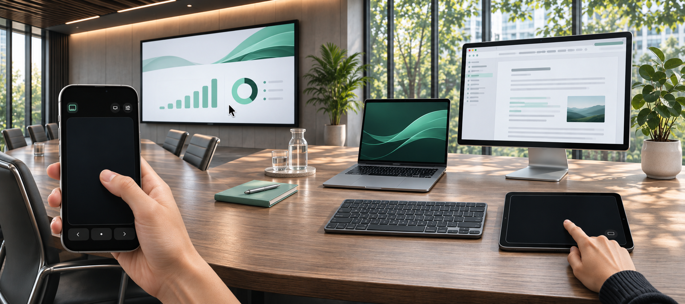

# UUTouch · UU触控板

UUTouch 把 iPhone 和 iPad 变成 Mac 的无线触控板，通过同一个 Wi-Fi 网络控制指针、点击和滚动。

## 两个典型场景

- **日常工作｜iPad mini 当大号触控板**。把 iPad mini 横放在键盘旁，在大面积触控区移动指针、滚动文档和选择内容。
- **工作汇报｜iPhone 当手持演示鼠标**。站在投屏前，用拇指在 iPhone 屏幕上滑动或轻点，操作 Mac 上的演示文稿和页面。

## 如何使用

1. **下载 Mac 安装包**。前往 [GitHub Releases](https://github.com/MichaelJiangg/UUTouch/releases/latest)，下载 ZIP，解压后把「UU触控板」拖进「应用程序」。支持 Apple 芯片和 Intel Mac，需要 macOS 14.6 或更新版本。
2. **在 iPhone 或 iPad 安装 [Apple TestFlight](https://apps.apple.com/cn/app/testflight/id899247664)**。收到 UU触控板的测试邀请后，打开邀请链接，在 TestFlight 安装测试版。
3. **将两端连到同一个 Wi-Fi**。在 Mac 上打开 UUTouch，按提示授予控制权限。进入「连接 → iPhone／iPad」，选择「配对新设备」，再用移动端扫描二维码或输入六位配对码。

[第三方许可证](licenses)
